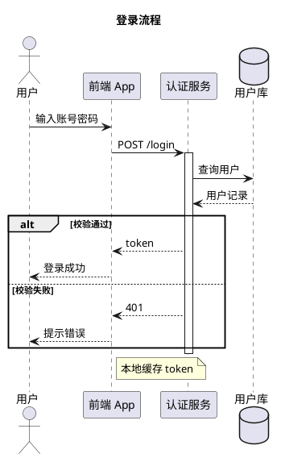
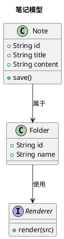
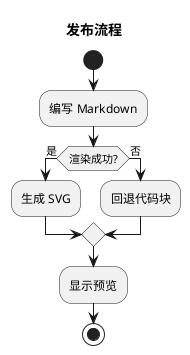

# Markdown 渲染测试

用于验证 Tools-X 本地 Markdown 预览的渲染效果与标题树，覆盖常用元素。

> 提示：打开本文件后，右上角可在「预览 / 源码」之间切换。

## 一、文本样式

普通文本、**加粗**、*斜体*、***加粗斜体***、~~删除线~~、`行内代码`，以及一个[普通链接](https://example.com)。

特殊字符检查：`1 < 2`、`a & b`、`"双引号"`、`'单引号'`、`<script>`。

### 二、引用与分隔线

> 一级引用：这是一段引用文字。
>
> 引用内也可以放列表：
>
> - 引用内的第一项
> - 引用内的第二项

---

## 三、列表

### 无序列表（含嵌套）

- 第一项
- 第二项
  - 嵌套项 A
  - 嵌套项 B
    - 更深一层的项
- 第三项

### 有序列表

1. 第一步：打开插件浮窗
2. 第二步：进入 Docs
3. 第三步：新建一篇笔记
4. 第四步：在预览中查看标题树

### 任务清单

- [x] 已完成的父任务
- [ ] 未完成的父任务
- [x] 已完成的父任务（带子任务）
  - [x] 已完成子任务
  - [ ] 未完成子任务

## 四、表格

| 功能 | 状态 | 说明 |
| --- | --- | --- |
| Docs | ✅ | Markdown 笔记与标题树 |
| JSON 工具 | ✅ | 格式化与比对 |
| md 预览 | ✅ | 打开本地 .md 自动渲染 |
| JSON 预览 | ✅ | 打开本地 .json / .jsonc 自动渲染 |

### 宽表格（检查横向滚动）

| 序号 | 名称 | 类型 | 版本 | 状态 | 作者 | 更新时间 | 备注 |
| --- | --- | --- | --- | --- | --- | --- | --- |
| 1 | docs-core | 模块 | 1.0.0 | 启用 | Tools-X | 2026-10-31 | 笔记与目录 |
| 2 | json-format | 模块 | 1.0.0 | 启用 | Tools-X | 2026-10-31 | 格式化与比对 |
| 3 | preview-md | 扩展 | 1.0.0 | 启用 | Tools-X | 2026-10-31 | 本地 md 预览 |
| 4 | preview-json | 扩展 | 1.0.0 | 启用 | Tools-X | 2026-10-31 | 本地 json / jsonc 预览 |

## 五、代码块

```javascript
// 高亮检查：注释、字符串、数字、关键字
const items = ['docs', 'json', 'jsonc'];
function pick(list, index = 0) {
  if (!list.length) return null;
  return list[index] ?? items[0];
}
```

```python
# Python 示例
def greet(name: str) -> str:
    values = {"ok": True, "count": 3}
    return f"Hello, {name}! {values}"
```

```bash
# Shell 示例
npm run build && echo "done"
for f in *.json; do echo "$f"; done
```

```json
{
  "name": "Tools-X",
  "version": "1.0.0",
  "features": ["docs", "json"],
  "active": true,
  "extra": null
}
```

```diff
- {"enabled": false}
+ {"enabled": true}
```

## 六、PlantUML 图

在 `puml` / `plantuml` 代码块中编写 PlantUML，预览时会离线渲染为 SVG（无需联网）。

### 时序图



### 类图



### 活动图



## 七、图片


## 八、长段落与标题层级

这是一段较长的文字，用于检查正文的换行、行高与阅读节奏。理论上它会在卡片宽度内自然换行，不产生横向滚动，也不会撑破布局。继续补充一些内容：Markdown 预览采用与 Docs 相同的渲染引擎，因此标题、列表、表格、代码块的表现应当保持一致。

#### 四级标题

四级标题用于验证标题树的第三层缩进。

##### 五级标题

五级标题用于验证更深一层的缩进效果。

###### 六级标题

六级标题用于验证最深层级的缩进，并确认标题树可以正常跳转。
